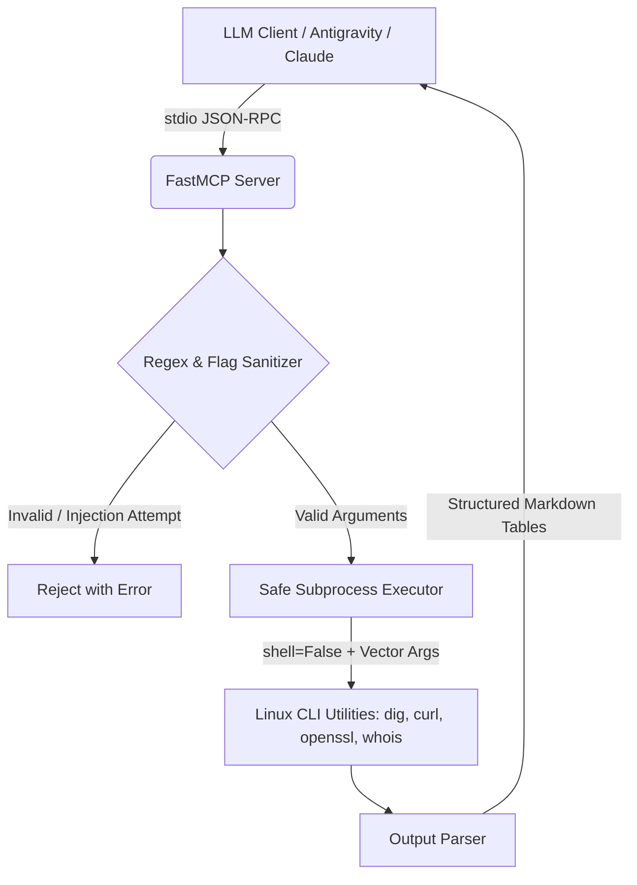

# Security & OSINT Python MCP Server

An Enterprise-Grade Model Context Protocol (MCP) server that exposes POSIX networking and OSINT utilities (`dig`, `curl`, `openssl`, `whois`) to LLM host environments like **Antigravity CLI**, **Claude Desktop**, and **Cursor IDE** via `stdio` transport.

Designed with **strict command-injection defense mechanisms** to prevent Remote Code Execution (RCE) during agentic tool calls.

---

## Architecture & Threat Model



### Security & Defense Engine Specs
* **No Shell Execution (`shell=False`):** Inputs are passed purely as argument vectors (`subprocess.run(["cmd", "arg"])`). Shell metasymbols (`|`, `;`, `&&`, `$()`, `` ` ``) are treated as literal characters and neutralized.
* **Option Flag Defense:** Parameters starting with `-` are rejected to block argument injection (e.g., `-o /etc/passwd`).
* **Strict Input Regex Validation:** Enforces RFC-compliant domain name and IPv4 format matching prior to command invocation.
* **Process Lifespan Isolation:** Enforces 10-second hard timeouts per subprocess call to avoid denial-of-service conditions.
* **Stdio Protocol Protection:** All standard logging is isolated strictly to `sys.stderr` to maintain clean JSON-RPC communication on stdout.

---

## Features & Tool Wrappers

| Tool Endpoint | Wrapped Binary | Description | Output Format |
| :--- | :--- | :--- | :--- |
| `dns_lookup` | `dig` | Resolves `A`, `AAAA`, `MX`, and `TXT` records. | Markdown Table (Record, TTL, Value) |
| `http_header_inspector` | `curl -I` | Audits security headers (`HSTS`, `CSP`, `CORS`, `X-Frame-Options`). | Security Compliance Audit Table |
| `ssl_cert_inspector` | `openssl s_client` | Extracts Subject, Issuer, SANs, and handshake status. | Executive TLS Summary Table |
| `whois_lookup` | `whois` | Queries domain registrar, creation, and expiration dates. | Domain Lifecycle Metadata Table |

---

## Quickstart

### Prerequisites
* Linux (Arch, Debian/Ubuntu, RHEL) or macOS
* Python 3.11+
* `uv` package manager (`sudo pacman -S uv` or `curl -LsSf https://astral.sh/uv/install.sh | sh`)
* System utilities: `dig`, `curl`, `whois`, `openssl`

### Installation

1. **Clone the repository:**
   ```bash
   git clone [https://github.com/your-username/security-mcp-server.git](https://github.com/your-username/security-mcp-server.git)
   cd security-mcp-server
   ```

2. **Audit local CLI dependencies:**
   ```bash
   uv run python -m src.security_mcp.audit
   ```

3. **Run unit & security defense tests:**
   ```bash
   uv run python -m src.security_mcp.test_defense
   uv run python -m src.security_mcp.test_tools
   ```

---

## MCP Client Configuration

Add this entry to your host client configuration file (e.g., `~/.config/antigravity/mcp_config.json`, `claude_desktop_config.json`, or `.cursor/mcp.json`):

```json
{
  "mcpServers": {
    "security-osint": {
      "command": "uv",
      "args": [
        "run",
        "--directory",
        "/path/to/security-mcp-server",
        "python",
        "-m",
        "src.security_mcp.server"
      ]
    }
  }
}
```

---

## Demonstration & Example Outputs

### Prompt:
> *"Conduct a security inspection on `example.com` and audit its HTTP security headers."*

### Server Output Returned to Agent:

### HTTP Header Security Analysis: `https://example.com`

**Status Line:** `HTTP/2 200`

#### Security Header Audit
| Header | Status | Value |
| :---    | :--- | :--- |
| **HSTS** (`strict-transport-security`) | `PRESENT` | `max-age=31536000; includeSubDomains` |
| **CSP** (`content-security-policy`) | `MISSING` | — |
| **Clickjacking Protection** (`x-frame-options`) | `PRESENT` | `DENY` |
| **MIME Sniffing Defense** (`x-content-type-options`) | `PRESENT` | `nosniff` |

#### Server Info
- **Server Header:** `ECS (8b54/1218)`
- **Powered By:** `Unspecified`

---

## License

Distributed under the MIT License. See `LICENSE` for details.
